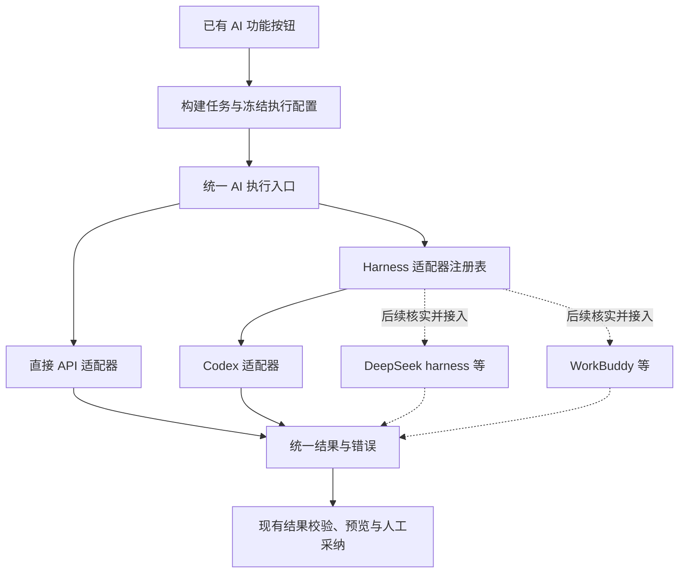

# AI 设置中的 Harness 执行方式设计

日期：2026-10-24。状态：用户已确认，2026-10-25 完成 Codex 订阅接入、凭据存储与运行时系统代理修正；隔离验证及当前账户的真实连接、一道单题解析与一次追问已通过。学习助手及其他 Harness 实现不在本轮范围。

实施约束更新：用户已明确选择 **只接订阅登录，暂不启用 Harness API Key 路径**。Codex 使用本应用专用环境中的官方 CLI 设备码登录；不读取桌面 Codex 或其他编辑器的登录凭据，不在订阅不可用时降级为 API 计费。原直接 API 设置保持独立。

用户当前希望项目把已有 AI 工作交给接入的 Codex 执行，在「AI 设置」中新增「使用 Harness」，以后考虑 DeepSeek harness、WorkBuddy 等接入。此前的[学习助手侧栏方案](2026-10-24-codex-learning-assistant.md)暂缓，不是当前开发范围。

本方案的核心是：**业务功能提出 AI 任务，统一执行层选择直接 API 或 Harness，结果回到现有校验、预览和人工采纳流程。** 首版支持 Codex；其他 Harness 预留适配边界，不提前实现或假定其协议相同。

## 1. 范围与现有代码

本次设计基于本地 `a1f6b1a5fa8c9e773f201123bac0b964c49c7ff8`，实施使用 `codex/desktop-ai-harness` 分支，遵循[协作开发分支规划](../../universal/协作开发分支规划.md)。执行与验证记录见[实施计划](../plans/2026-10-24-ai-harness-execution.md)。

现有 [AI 设置页面](../../../apps/web/index.html) 位于 `ai-settings`；[共享业务](../../../apps/web/app.js) 中的 `requestAiChatV99` 是统一请求入口，底层走 `ShirohaPlatform.network.ai`。以下任务保持原入口和业务含义：

| 现有任务 | 给执行层的材料 | 回到项目的结果 |
| --- | --- | --- |
| 导入整理 | 用户选定的原始题目文本及答案文本 | 结构化题目或整理后的文本，再进入已有解析和预览 |
| 批量核对 | 导入预览中选定题目、题目标识及指纹 | 问题和修改建议，由用户逐项采纳 |
| 批量补解析 | 导入预览中选定题目 | 解析建议，由用户核对后使用 |
| 单题解析 | 当前题干、选项、参考答案、作答草稿及图片缺失标记 | 解析、参考作答、置信度与核对提示 |
| 单题追问 | 当前题、初始解析、当前解析草稿、已有对话及本次问题 | 追问回复和可独立保存的完整解析 |

连接测试是另一类技术探测，不计入学习任务。MinerU 和 OCR 不经过当前 AI 请求入口，本轮不改为 Harness 执行。生成新练习、全库诊断、后台自动任务和独立聊天侧栏不在首版范围。

各任务沿用自己的业务规则：导入整理不得编造题目或重新解题，批量补解析以已有答案为准；单题解析则允许独立判断并提示与题库答案的差异。不能为了统一执行器把这些不同规则合成一份通用提示词。

「Harness」在本方案里指承接任务并管理模型/工具执行过程的运行程序或服务；模型供应商与 Harness 分开。单纯增加一个兼容模型 API 地址仍属于直接 API 方式，不应仅因模型名称不同而新增 Harness 适配器。

## 2. AI 设置交互

推荐用互斥选项明确表达当前执行方式，保留用户要求的「使用 Harness」文案：

```text
AI 设置

执行方式
  ○ 直接调用 API
  ● 使用 Harness

Harness         [ Codex              v ]
运行配置        [ 本机 Codex 专用配置  ]
状态            已检测到 / 待授权 / 可用 / 不支持
模型            [ 默认，或此 Harness 提供的选项 ]
任务超时        [ 120 秒 ]

[检测环境]  [配置授权]  [测试执行]  [保存设置]
```

- 直接 API 模式继续展示服务类型、接口地址、模型和 Key；Harness 模式展示运行配置及授权状态，不要求填写 Chat Completions 地址，也不沿用 `endpoint && model` 判断可用性。
- 第一版下拉框仅提供已实现并通过验证的 Codex。DeepSeek harness、WorkBuddy 暂列为后续接入方向，不做能选中却无法执行的空选项。
- 模型选项属于所选适配器；允许使用运行时默认值，但要能识别默认值变化。支持的任务、结构化输出与取消能力展示在状态详情中。
- 「检测环境」只检查版本、启动/握手和本地配置，不调用模型；「测试执行」发送固定、无用户题目的小任务，明确可能消耗当前账户用量。只有完整结果通过校验才显示测试成功。
- 切换模式保留另一种方式的配置。任务执行期间可以编辑设置草稿，但须等待任务结束或明确停止后才能保存切换，不在批处理的中途换执行器。
- 现有 AI 按钮随执行方式更新就绪状态和错误提示；不可继续给 Harness 错误套用 CORS、Chat Completions URL 等 API 专属诊断。
- 清除配置针对当前方式，明确是否解除授权；不顺带清除另一种方式的 API Key 或运行配置。

首次在 Windows 桌面实现 Harness。Web 保留直接 API，并说明本地 Harness 需要桌面环境；不为了浏览器支持新建公开本机服务。Android 原生功能不在本轮修改范围。

## 3. 统一任务执行层



首版是小型内置适配器注册表，不建设插件市场、动态执行脚本或通用工作流引擎。业务层不出现按 Codex、DeepSeek、WorkBuddy 分支的提示词和保存逻辑。

首轮落实为统一的 `HarnessApi` 平台接口与受控原生任务枚举，当前原生层仅接受 `adapter: codex`。还没有需要动态选择的第二个实现，因此暂不增加动态注册机制；后续接入需新增独立适配器并通过同一任务、取消和结果契约，不改业务入口。

### 3.1 任务与结果契约

拟议 `AiTaskRequest` 包含 `requestId`、`taskKind`、`taskVersion`、应用控制的任务指令、业务上下文、输出约束、超时、输出大小限制及执行配置引用。`taskKind` 使用前述五类业务枚举；外部题目内容始终作为数据。第一阶段可以适配现有消息构造函数，不重写全部提示词。

拟议结果包含最终 `content`、执行器标识、版本、完成状态，以及运行时确实提供的用量和警告。适配器内部消费进度事件，业务侧继续等待一次完整结果；事件日志、推理项或命令输出不能混入最终解析。

不把所有执行器伪装成 HTTP `Response` 或 `choices[0].message`。现有 API 封装保留其响应解析；统一层返回与传输无关的结果。现有连接测试依赖 `result.payload`，实施时改为检查任务成功和输出有效，不能用一个虚构非空对象蒙混通过。

执行状态至少包括准备、运行、停止中、成功、失败、已取消和结果未知；错误区分未安装、版本不支持、未授权、能力不支持、超时、额度/网络错误和输出无效。API 诊断和 Harness 诊断各自保留必要细节并脱敏。

### 3.2 适配器的最小职责

| 能力 | 作用 |
| --- | --- |
| `inspect` | 检测安装、版本、授权状态及实际支持的任务能力 |
| `configure` | 配置该执行器的专用运行环境与授权入口 |
| `execute` | 接收冻结的任务，产生进度并返回最终结果 |
| `cancel` | 停止指定任务并确认终态，超时则处理自己创建的进程 |
| `dispose` | 关闭受控资源；不注销用户在其他产品中的账户 |

能力信息区分可执行任务、文本/图片输入、原生 schema 输出/文本后校验、取消、会话和审批能力。首版只需文字任务；不能因为某适配器不支持 JSON Schema 就跳过项目结果校验。缺少必要能力时在发送前报错，不自动切换供应商。

某个运行时将来只提供 GUI 时，不能自动视为可集成；要先核对其正式 CLI、SDK、IPC 或服务协议。DeepSeek harness、WorkBuddy 的具体产品、版本、登录和可编程接口尚未调研，本文不声称已具备这些能力。

## 4. Codex 首个适配器

当前需求是由应用发起有明确输入输出的任务，建议优先验证 `codex exec` 的非交互模式：通过 stdin 输入，消费 JSONL 事件，用输出 schema 约束最终结果，并在可用时采用临时会话模式。官方提供这些能力。[Codex 非交互模式](https://learn.chatgpt.com/docs/non-interactive-mode)

这调整了前稿固定采用 App Server 的结论。**首选非交互任务接入，App Server 作为同一 Codex 适配器内部的备选传输**；若目标版本的认证或中断要求必须用 App Server，P0 核实后选择它。业务入口不因此改变，第一版不同时维护两套正式传输。App Server 本身仍可用于后台客户端，并不要求产品提供聊天侧栏。[App Server](https://learn.chatgpt.com/docs/app-server)

一次调用执行一个完整任务；批量核对由现有业务循环安排批次。单题追问继续由项目提供已冻结的历史，初期每次独立执行，避免同时使用 Harness 历史和应用历史造成重复上下文或跨题泄漏。

Codex 实现需要核实并固定运行版本、schema 和认证接法；P0 中不把当前机器的内部 alpha 可执行文件当发行依赖。后台启动固定可信程序、使用参数数组和 stdin，不把题干放进 shell 命令或命令行参数；前端不能传任意 executable、argv、环境变量或工作目录。

认证由适配器拥有，通用执行层只接收不透明运行配置 ID。配置应限定到 Shiroha 的专用环境，保留前稿关于独立授权、秘密不入备份和账户隔离的边界。公开本地开源分发优先核对 Sign in with ChatGPT 流程；该接法与 `exec` 的组合需单独验证，不能把 App Server 的认证示例直接当作已测试的 `exec` 用法。[本地开源应用授权](https://developers.openai.com/siwc/token-sharing-open-source)、[App Server 授权接法](https://developers.openai.com/siwc/token-sharing-open-source/codex-app-server)

本轮不实现 Harness API Key。正式登录只在用户点击后启动；设备码登录可能需要账户或管理员启用，失败保持不可用。普通关闭保留专属系统凭据，退出登录只处理此专属环境。通用接口不要求未来所有 Harness 使用 OpenAI 的登录方式。

2026-10-25 凭据存储修正：保持 `cli_auth_credentials_store="keyring"`，启用固定官方版本的 `features.secret_auth_storage=true`。由官方实现把加密密钥存入系统 keyring，把授权内容加密保存在本应用专属 `ai-execution/profile`；不由应用实现另一套加密或读取其他产品的授权。这属于适配器原生凭据机制，避免把整份 OAuth JSON 直接写入 Windows 单项凭据时的容量限制。系统密钥不可用、密文损坏或路径校验失败时保持不可用，不回退到明文 `auth.json`；密钥、密文与其引用都不进入题库、业务数据库、日志或跨端备份。

授权启动前仍持久记录待清理状态；登录失败、取消或结果未知后，不因刷新状态或发现凭据就自动恢复可用。只有完整登录成功并确认状态，或完成显式授权清理，才能解除相应阻塞。错误提示按已确认的失败阶段说明，不把所有授权失败都归因于设备码开关，也不把未完成的登录一律描述成退出失败。此存储修正不改变工具禁用、进程隔离、严格登录状态判定与结果校验；修正后的工具边界仍须随验证配置复核。

本轮采用官方 CLI 原有订阅登录，**不声称已实现 Sign in with ChatGPT 的第三方 OAuth 客户端注册流程**。面向公开分发的认证方式与真实账户验收仍需独立完成；不能把隔离假服务通过当成订阅权益或授权条款验证。

## 5. 兼容现有行为

### 5.1 准确选择执行器

优先在 `requestAiChatV99` 附近引入统一分派，保持五类任务的构造、解析和人工采纳流程。调用者补充明确的任务类型和输出约束；新增模块承载适配逻辑，不继续把所有实现写入大型 `app.js`。

一次完整业务操作开始时冻结执行方式、配置版本、模型选择、任务参数和上下文指纹；整个批次和导入的后续整理步骤沿用同一份配置。保存设置、恢复备份、切账户和应用退出均纳入取消及旧结果失效处理。

现有 API 的 `response_format` 请求被 HTTP 400/422 拒绝时会尝试普通请求，这是 API 适配器的兼容行为，不扩散到 Harness。导入的「结构化整理 → 文本整理」属于已有业务后续步骤；当前实现会捕获较宽泛的非取消异常，可能在鉴权或传输失败后再次请求。接入时须先补回归，再将该业务兜底限定为上一阶段明确完成但结构化结果不可用的情况；优先使用同一结果中的整理文本。失败、超时、取消或结果未知不得触发再次生成。

就绪判断收拢到一个执行状态入口，由它输出当前方式、可用性、任务能力及原因；导入、批量、单题和设置页共同使用，避免只更新请求入口而遗漏各处 `endpoint && model` 检查。

不能要求 Harness 支持所有现有 API 参数。温度、输出 token 上限等按能力转换；无法原生执行的限制明确说明并在宿主层落实可落实的文本/字节限制，不能宣称本地截断能够严格限制服务计费。

### 5.2 配置存放与跨端备份

现有 `normalizeAiConfigV99` 会移除未知字段；`exportSettingsV1` 与[备份校验](../../../apps/web/platform/validation.js)只允许原有五项 AI 配置字段。因此不能仅往 `aiImportV99` 添加 `useHarness`。

首版建议：现有 `aiImportV99` 原样保存直接 API 设置；执行方式及 Harness 配置放入桌面私有、带版本的执行设置，通过类型明确的平台接口读取。配置存储原子写入，保存成功后才更新活动路由；首次安装默认直接 API。

桌面私有配置只保存模式、适配器 ID、运行配置引用、可选模型和超时；秘密由各适配器的原生凭据机制保存。运行路径、账户绑定及执行设置不进入跨端题库备份；恢复题库不会在另一台机器自动启动 Harness。桌面本机恢复时取消活动任务并要求重新确认可用状态，不静默切回 API 发请求。

旧备份正常导入，Web/Android 不需要理解 Harness。遇到已保存但当前不可用的适配器，明确显示不可用并由用户选择切换。清除当前方式配置、清除题库、恢复备份及退出登录的语义分别测试。

### 5.3 结果与写入

执行器只提交候选结果，原有解析器继续验证字段、题型、答案匹配和长度。保留题目指纹、练习所有者、请求 ID、配置 generation 等校验，迟到结果不得覆盖新题或新执行器的输出。

批量建议仍需逐项核对，单题解析仍需主动保存；保持已有覆盖确认、保存失败留稿与回执重试。Harness 不直接访问 SQLite 或修改题库，不调用判题、提交答案或更新掌握状态。无效结果显示为失败，不静默导入部分内容。

## 6. 权限、取消与失败

现有任务只需要把有限文本转成候选文本或 JSON，第一版给 Harness 的工具权限为最小集合：不开放本机命令、任意文件、浏览器、额外插件或后台任务。未来若某项业务确实需要工具，新增任务版本及明确工具范围，而不是把「使用 Harness」理解为开放全部代理能力。

采用专用运行目录和配置，不继承用户的项目规则、MCP、hooks 或历史。只读沙箱仍可能运行命令和读取文件；工具禁用及配置隔离必须在目标运行时实测。不满足条件时标记适配器不可用，不能用提示词或自动批准越权请求代替约束。[Codex 沙箱与审批](https://learn.chatgpt.com/docs/agent-approvals-security)

原生 IPC 保留主窗口与本地来源校验。子进程网络不会自动受现有 AI 网络 mock 或 CSP 约束，测试必须使用假执行器；正式认证与模型访问保持 TLS 验证并使用选定服务。

2026-10-25 运行时网络修正：启用固定官方 Codex 0.163.0 的 `features.respect_system_proxy=true`，让 HTTP 与 WSS 共用官方系统路由；Windows 实现支持手动代理与 PAC/WPAD。已选定代理后的连接失败不得回退直连；系统代理发现不可用时，官方实现仍会尝试环境代理再直连。本应用继续使用清空继承环境的 9 项白名单，不继承启动器代理、令牌或用户全局配置。`features.system_proxy_fallback` 保持关闭，其余工具特性仍关闭；仅系统代理和加密凭据存储两项非工具特性开启。组件下载器仍采用独立的静态 HTTP/HTTPS 系统代理解析，不声称它具备 PAC/WPAD 支持。

首轮真实连接测试只读采样看到直连远端 443 的 TCP 处于 `SynSent`，未见回环代理连接；该轮从界面停止，未取得成功模型返回。代理修正后正常重启保留真实订阅登录，连接测试、一道单选题解析及一次追问成功，解析期间采样确认到本机代理的已建立连接。结果仍保持草稿、未提交作答或写入题库；当前手动代理实测不能替代其他题型、账户及 PAC/WPAD 环境验收。

取消既停止当前执行，也停止尚未开始的后续批次；保留已完成批次的待核对建议及已有单题解析草稿。停止中不得立即启动同一业务任务的新执行。进程无法响应时只结束本应用创建并核实身份的进程树。异常退出或连接丢失后结果未知，不自动重发；保存已经成功时取消不能撤销该提交。

收起 AI 区域只影响界面；关闭应用进入现有关闭协调并停止任务。普通关闭不撤销用户记住的授权，退出登录才执行适配器的注销流程。运行日志只保留脱敏状态、版本及任务标识，不记录题目全文、对话、Key 或令牌。

## 7. 落地顺序与验收

本次已获实施授权，按失败回归、实现、验证的顺序推进。

| 阶段 | 交付与验收 |
| --- | --- |
| P0：Codex 可行性 | 固定版本，选定一种正式传输；验证授权、输出、工具隔离、取消和异常退出；无真实用户数据 |
| P1：执行层与设置 | API/Harness 模式、私有配置、能力检查、API 适配器及假 Harness；原有 API 回归通过 |
| P2：Codex 接入现有任务 | 五类任务及连接测试都经统一执行层；原有预览、追问、保存、停止和失败提示保持有效 |
| P3：第二个 Harness | 在确定具体产品及官方协议后实现独立适配器；复用同一任务契约和测试集验证扩展边界 |

重点回归：旧配置无损、模式保存失败回滚、批次中切换、任务类型分派、API 参数回退隔离、结构化输出校验、超时/取消/进程崩溃、结果未知不重试、跨题同 ID、题目修改、备份恢复、无自动判题、无未经确认保存及无秘密进入备份。

按改动执行桌面 npm 测试、typecheck、lint；Rust fmt/Clippy/test；build、build:test 与隔离 test:desktop；共享单题 AI 回归。新增原生测试使用 fake Harness，禁止启动真实 Codex 或访问真实收费服务。文档阶段只运行文档检查。

本方案接受用户当前的产品方向；本轮授权包含 Codex 接入和验证，不包含学习助手、其他 Harness 实现、提交、推送或发布。
