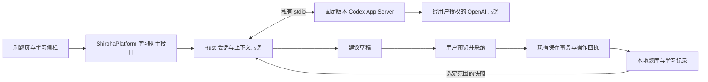

# Codex 学习助手嵌入设计

日期：2026-10-24。状态：暂缓，未批准、未实施。

用户后续明确暂不开发独立学习助手，当前优先在「AI 设置」新增 Harness 执行方式，将项目已有 AI 任务交给 Codex，并保留其他 Harness 的接入空间。后续设计以[AI Harness 执行方式](2026-10-24-ai-harness-execution.md)为准；下文保留为历史讨论参考，不作为当前实施依据。

用户已明确用途为「学习助手：讲题、分析错题、生成练习」。本方案面向 Windows 桌面版，在现有刷题界面旁提供类似 VS Code 的常驻对话侧栏。

建议采用 **本地学习面板 + Rust 受控服务 + Codex App Server 的私有 stdio 连接**。第一版提供连续讲题、选定错题分析、练习草稿和人工采纳；保留已有单题 AI。先验证登录、协议与工具限制，再进入完整功能开发。

## 1. 依据与当前状态

本次只读核对的基线为 `a1f6b1a5fa8c9e773f201123bac0b964c49c7ff8`。当前工作树处于 detached HEAD；本次仅形成设计文档。实施前按[协作开发分支规划](../../universal/协作开发分支规划.md)核对主线并绑定任务分支，不能把本文视为提交、推送或发布授权。

| 当前能力 | 源码依据 | 设计影响 |
| --- | --- | --- |
| Tauri 2、WebView2，共享原生 HTML/CSS/JS | [桌面配置](../../../apps/desktop/src-tauri/tauri.conf.json)、[资源生成器](../../../apps/desktop/scripts/prepare-web.mjs) | 沿用当前技术栈，新增本地面板，不引入 React，不手改 `dist` |
| 实际平台入口为 `ShirohaPlatform` | [运行时类型](../../../apps/web/platform/runtime.d.ts)、[桌面适配器](../../../apps/desktop/frontend/adapter.js) | 新增可选学习助手能力；不能把契约声明误当作已经实现的服务 |
| 原生 AI 请求明确拒绝流式响应 | [网络实现](../../../apps/desktop/src-tauri/src/network.rs) 的 `Network::ai` | 独立承载 Codex 会话，不把 `service_request` 改成任意协议代理 |
| 单题 AI 已有题目指纹、请求取消、迟到结果隔离和保存解析入口 | [共享业务](../../../apps/web/app.js) 的 `aiSingleSessionV613`、`runAiSingleAnalysisV613`、`saveAiSingleAnalysisV613` | 复用业务规则和保存流程，新增会话能力 |
| 数据支持按需正文加载、修订检查和操作回执 | [适配器](../../../apps/desktop/frontend/adapter.js)、[存储](../../../apps/desktop/src-tauri/src/storage.rs) | 发送前加载所选正文；采纳先校验来源，保存失败保留草稿 |
| 原生命令只允许主窗口和指定本地来源 | [命令授权](../../../apps/desktop/src-tauri/src/commands.rs) | 新 IPC 继续经过相同入口校验，前端不得获得通用进程或文件权限 |

练习中允许用户主动调用 AI，保存解析不触发判题；这是[已确认的提交模式设计](2026-10-24-practice-submit-modes.md)中的现有行为，继续保留。考试流程第一版不接入新助手，避免未经设计改变考试行为。

全局规范引用的 `global-rules/AGENTS_condition_rules.md` 在本工作树不存在。状态规则以根规范、已确认设计及现有实现为依据，不推测缺失文件内容。

## 2. 接入方式选择

官方将 App Server 定位为自定义客户端的深度集成接口，VS Code 扩展也使用这一接口；它提供会话、流式事件与审批交互。本文选择本地 stdio；官方仍标注部分能力为实验性，应固定经过验证的版本。官方文档还明确标记动态工具接口为实验性。[Codex App Server](https://learn.chatgpt.com/docs/app-server)

| 路线 | 适合什么 | 本项目决策 |
| --- | --- | --- |
| 自绘面板 + App Server | 需要持续会话、流式状态和后续业务工具的桌面产品 | 推荐；Rust 直接管理进程及协议 |
| Codex SDK / 非交互任务 | 由程序启动的批处理或独立任务 | 当前不增加另一层运行时；批量后台任务以后再评估 |
| 直接调用 Responses API | 产品自己管理历史和工具调用，只需要模型能力 | 保留为技术替代选项；若 App Server 不能满足权限边界，重新确认此路线 |
| 承载现成插件或远程页面 | 希望复用完整第三方界面 | 本项目没有 VS Code 扩展宿主，现有 CSP 也禁止 iframe；不作为本次实现方案 |

官方分别提供非交互、SDK 和 App Server 接入路径；选择依据是产品需要的会话与交互控制。[Codex 平台介绍](https://developers.openai.com/blog/codex-as-a-platform)

## 3. 界面与学习流程

桌面右上角增加「学习助手」入口。宽窗口使用右侧面板，默认建议宽度 380px，可在 320–520px 间调整；主内容不足约 640px 时改为抽屉，避免压缩题干。尺寸是设计初值，需在 900px 最小窗口与高 DPI 下验收。

```text
┌────────────────────────────────┬────────────────────────────┐
│ Shiroha Quiz · 刷题练习         │ 学习助手  新对话  历史  收起 │
├────────────────────────────────┼────────────────────────────┤
│ 题干、选项、作答区             │ 当前关联：高数 / 第 12 题   │
│                                │ 发送内容：题目、当前作答    │
│ 保留上一题、下一题、提交按钮   │ [讲解这题] [提示思路]       │
│                                │ [分析错因] [生成同类练习]  │
│                                │                            │
│                                │ 连续对话 / 来源 / 草稿预览 │
│                                │ [保存解析] [预览练习]      │
│                                │                            │
│                                │ 输入追问…   停止 / 发送    │
└────────────────────────────────┴────────────────────────────┘
```

| 场景 | 交互 | 产出与限制 |
| --- | --- | --- |
| 讲题 | 用户选「讲解这题」并发送，之后可连续追问 | 说明知识点、步骤和易错点；区分题库参考答案与 AI 推断 |
| 提示思路 | 使用单独的新会话，只提供题干、选项与作答草稿 | 不发送答案和已有解析；不复用已透露答案的会话，也不宣称能阻止模型自行推导答案 |
| 错题分析 | 用户勾选题目或选定一次已完成记录，再发送 | 错误类型及训练建议标记为 AI 分析；错误率等事实由本地计算并标明样本数 |
| 生成同类练习 | 选题型、数量、难度；默认 5 道、单次上限建议 10 道 | 先返回带答案、解析的草稿，经校验和预览后加入单独题库 |
| 保存讲解 | 用户打开修改预览并点击采纳 | 第一版只允许修改目标题解析；已有解析须显示替换内容，不改变答案和成绩 |

打开面板、切换题目、切换页面均不自动产生模型请求。面板中的上下文标签明确显示当前会话关联对象；切题后提示「仍在讨论上一题」，通过「关联当前题目」建立新的单题会话。跨题讨论须显式追加所选题目。

默认保留对话上下文，避免反复粘贴；每次发送都展示本轮新增的材料范围。删除附件只影响后续发送，不能撤回已发给服务的内容；需要排除旧上下文时新建会话。

面板使用语义化控件，提供键盘开关、可访问名称和状态播报；输入框接收回车时不触发练习快捷键，兼容中文输入法。抽屉约束焦点、关闭后恢复焦点，减少动态效果设置优先。流式播报按段落或状态合并，不逐 token 打断读屏。

## 4. 架构与模块职责



上图是拟议架构。App Server 发起自己的模型网络请求，现有 Rust AI/WebDAV 网络拦截器不会自动约束这个子进程，测试隔离与出站策略必须单独处理。

| 位置 | 拟议职责 |
| --- | --- |
| `apps/desktop/frontend/codex-panel.js`、配套样式 | 桌面侧栏、会话列表、上下文标签、流式展示、草稿预览 |
| `apps/desktop/frontend/codex-adapter.js` | 类型明确的业务调用、事件归并及取消；不接受任意 JSON-RPC 方法 |
| `apps/web/platform/runtime.d.ts`、`contracts.d.ts` | 实际平台能力、上下文引用和事件类型；Web 无该能力时隐藏入口 |
| `apps/web/app.js` 的小范围接缝 | 当前题目/记录定位、草稿读取、进入导入预览、人工采纳；复用既有业务函数 |
| `apps/desktop/src-tauri/src/codex/` | 进程监督、协议兼容、认证、会话索引、上下文快照、提案校验 |
| 桌面资源生成器、命令注册与权限配置 | 打包本地资源，注册逐项业务命令，保持生产 CSP |

不修改题库备份主格式，不把 Codex 会话数据混入学习记录。新模块名称为设计建议，正式文件划分在设计批准后的实施计划中确定。

### 4.1 前端可调用的业务能力

拟议接口集中为运行状态、登录/退出、会话创建/列表/恢复/删除、上下文准备、发送、取消、草稿预览及采纳。其参数使用业务 ID、枚举与长度受限文本，返回脱敏错误和不透明 ID。

前端不能传入可执行文件路径、启动参数、`cwd`、环境变量、任意远程 URL、SQL 或原始 Codex 协议对象。选择运行程序或打开登录浏览器由专用原生命令处理。

协议适配层负责 `initialize` / `initialized`，线程创建与恢复、turn 发送及中断；正文增量与完成状态转换成产品事件。按目标二进制生成协议类型并固定版本，不把网上示例当成所有版本都支持的契约。[协议及 schema 生成说明](https://learn.chatgpt.com/docs/app-server)

### 4.2 进程与事件生命周期

- 用户首次打开并启用助手后懒启动；同一应用实例、同一账户最多一个受控服务进程，第一版全局最多一个运行中的 turn。
- 所有消息绑定 `sessionId`、`turnId` 和本地 `generation`。重连、切账户、恢复数据或清除历史时提升 generation，拒绝旧事件和旧审批。
- 协议响应按请求 ID 对应，通知按 turn/item 对应；有界缓冲、限制消息尺寸，UI 合并增量刷新。失去同步时暂停发送并恢复已持久化会话，不继续拼接残缺结果。
- 停止先发中断，确认终态后才允许新 turn；超时则终止本应用创建的子进程树，保留已收到文本并标记「已中断」。取消不承诺撤销服务用量。
- 不自动重发可能已经送达的生成请求。崩溃后查询/恢复会话，结果无法确定时显示「状态待核对」，由用户决定再次发送。
- 退出复用现有关闭协调，处理运行任务与未保存草稿；强制结束只作用于本应用记录的 PID、创建时间及进程树，不使用按名称批量结束进程。

建议业务状态为「未启用 → 启动中 → 待登录/就绪 → 生成中 → 已完成/失败/中断」；建议草稿另有「待核对 → 应用中 → 已保存/冲突/保存失败」，避免把对话成功当作数据保存成功。

## 5. 登录、凭据和模型

### 5.1 推荐的账户路线

本仓库已有开源许可证，设计以本地开源分发为前提。正式接入优先采用 **Sign in with ChatGPT 的开源本地应用流程**：用户在系统浏览器中为 Shiroha Quiz 单独授权。该流程提供符合条件的 ChatGPT 计划用量，并不授权读取用户现有 ChatGPT 聊天。[适用范围](https://developers.openai.com/siwc/token-sharing-open-source)

首次注册使用官方动态注册入口，后续保留签发的 client ID 与稳定 host ID；认证由 Rust 处理 state、nonce、PKCE、回调及身份校验。账户与 workspace 分别建档；不得只用邮箱判断同一身份，也不得读取 VS Code 或用户全局 Codex 的令牌文件。[注册流程](https://developers.openai.com/siwc/token-sharing-open-source/sign-in)

App Server 使用该账户授权的 access token 调用模型；本应用负责续期。按当前官方 env-key 接法，续期后需要重启受控进程并恢复线程；模型列表仅作候选目录，不能证明账户已获得对应模型访问权。[App Server 接入此登录流程](https://developers.openai.com/siwc/token-sharing-open-source/codex-app-server)

备用提供「使用自己的 OpenAI API Key」，清楚区分按 API 使用量计费与 ChatGPT 计划用量；不得在额度不足时自动切换计费来源。已有兼容 AI 服务的 Key 不自动迁移给 Codex。认证方式影响计费和数据设置。[Codex 认证说明](https://learn.chatgpt.com/docs/auth)

官方现在建议已有本地/开源 App Server 认证集成迁移到 Sign in with ChatGPT，并明确旧的 App Server 认证不能用于商业或托管服务。未来改变分发方式时重新核对适用流程；本方案不承诺任意商业分发可复用订阅登录。[App Server 认证边界](https://learn.chatgpt.com/docs/app-server#auth-endpoints)

### 5.2 本地凭据与续期

- 默认凭据仅驻留进程内存；用户选择记住时进入独立的 Windows 凭据命名空间。凭据管理器不可用时报错，不能退回明文文件。
- access token、refresh token、ID token、API Key 不进入前端持久状态、题库、导出、云备份、诊断日志或子进程命令行。只向所需子进程提供 access token，refresh token 留在原生认证服务。
- 为每个账户注册隔离 Codex 状态目录与会话索引。切账户先停止原有请求，身份校验通过后启用新账户；不自动把旧账户线程带入新账户。
- 续期提前安排在空闲时；运行中发生失效则先核对 turn 状态，恢复会话而不自动重发原提示。退出登录时停止请求、按官方流程尝试撤销并清除本地秘密；离线时明确显示远端撤销尚未确认。普通关闭应用只结束受控进程、清理内存，不撤销用户选择记住的登录。[账户与会话管理](https://developers.openai.com/siwc/token-sharing-open-source/profiles-and-sessions)
- 用户界面显示当前账户、认证方式和实际可获得的用量信息；没有数值时显示未知，不伪造剩余额度或费用。模型和推理档位从经过验证的运行时能力生成，不硬编码某个型号。

该 ChatGPT 计划接入仍存在预览限制；本地线程可恢复不代表具有云端聊天同步，不能默认使用托管 file search、Code Interpreter 或 hosted MCP。本方案的首版数据由宿主准备。[预览限制](https://developers.openai.com/siwc/token-sharing-open-source/preview-limitations)

## 6. 上下文、建议和数据保存

### 6.1 冻结每次发送的上下文

每次发送前，按所选引用加载正文并生成不可变快照：题库 ID、题目 ID、题目指纹、数据修订、练习实例、作答草稿、附件清单、会话和账户身份。后端生成短期上下文 ID；前端传 ID，不自行指定数据库路径。

单题讲解只发送所选题目的题干、选项、参考答案、已有解析和用户愿意附带的作答。提示模式排除答案和已有解析。题库备注、学习记录及整库内容默认不附带，扩大范围需用户重新选择并发送。

分析历史错题优先使用当时记录快照，标注「作答时题目」；当前题库已编辑时不可把新答案当成当时判分依据。选中的错题建议每批最多 20 道，超限先选范围或先生成本地汇总，不能静默截断后宣称分析了全部错题。上限作为具名配置，实施时按实际上下文容量验证。

第一版先支持文字与公式。含关键图片的题目明确显示「图片尚未发送，分析可能不完整」，用户补充文字或等待后续图片支持；不把本地路径发给服务，不让模型按路径读取图片。后续图片接入须经过预览、媒体令牌、大小限制和模型能力验证。

题干、导入文档及模型输出均是业务数据，不可充当系统指令、工具配置或自动执行脚本。模型输出经现有安全渲染路径展示，不直接插入未经清洗的 HTML，不自动加载远程图片或执行链接。

### 6.2 人工采纳与幂等保存

解析建议和练习草稿具有独立 `proposalId`，绑定来源快照、账户、目标、原始内容指纹与有效期。最终保存流程为：

1. 生成完整、通过结构校验的草稿；未完成流式文本只供阅读，不能直接保存为正式内容。
2. 用户查看目标、原内容、新内容及 AI 来源标识后点击采纳。
3. 原生层检查上下文仍有效、目标仍存在、来源指纹与当前修订匹配，拒绝越权目标和已撤销提案。
4. 通过已有 `runMutation` / 保存队列 / 原生提交入口保存；由固定的业务转换生成解析更新或新题库，不接受模型自行构造的任意 `changes`。
5. 提案定稿后一次性分配并持久保存题库/题目 ID，冻结最终载荷与操作 ID；重复点击及回包丢失先查操作回执，结果未知时暂停改稿和再次提交。明确未提交后，用户修改草稿或冲突后重新定稿时生成新提案版本与新操作 ID，不能用旧 ID 提交不同内容。失败保留草稿，成功回执后才标记已采纳。

采纳时的指纹也包含现有解析，避免旧单题 AI 与新侧栏同时打开时覆盖彼此刚保存的内容。

保存解析只改解析，不把题目判对，不替用户填写答案，不删除错题，不推进掌握状态。练习草稿先校验题型、选项、答案引用、数量与长度，预览阶段允许人工编辑；确认后统一分配新 ID 并写入单独题库。明确标注 AI 生成；复用现有合法扩展字段前先做 Web/桌面/Android 往返验证，不把新字段必然无损视为既有事实。

批量练习采用一次原子提交，失败不保留半份题库。退出练习、恢复备份、重置、删除题库、撤回授权或切账户均撤销待执行提案；取消生成不能撤销已经提交成功的数据操作。

### 6.3 会话持久化与清理

App Server 线程历史放在应用私有、按账户隔离的状态目录；应用维护独立的会话索引和待采纳草稿库，包含版本、上下文指纹、提案状态与提交回执。模型原始历史以运行时为准，不同时维护两份可编辑的权威对话。

上下文可能包含题目和作答，属于用户数据。首次启用时告知本地保存范围，提供查看、显式导出和删除入口；普通题库备份默认不包含会话，已采纳解析/练习仍随原题库备份。删除会话必须覆盖应用索引、草稿、附件及所固定运行时保存的对应历史；仅隐藏或归档不算删除。若目标版本没有可靠清理入口，先不发布持久历史功能。

仅退出登录保留本地会话供原账户再次进入，但不能由另一账户恢复发送；提供单独清除此账户本地记录的操作。数据重置/恢复时停止所有 turn 并使上下文失效，保留的历史只读，恢复后必须重新选题建立新会话。所有清理先核对路径在对应私有目录内并拒绝 junction 越界，不扫描用户全局 Codex 目录。

## 7. 工具权限与运行环境

**第一版由应用主动提供上下文，Codex 不获得题库数据库、文件目录或操作系统命令工具。** 生成练习和建议是输出草稿，实际写入由用户界面驱动现有保存流程，因此首版不需要 MCP 或动态工具。

官方配置可关闭命令执行工具；但只读沙箱仍可执行获准的命令和读取文件，不能用「read-only」替代完整权限设计。[配置参考](https://learn.chatgpt.com/docs/config-file/config-reference)、[沙箱与审批](https://learn.chatgpt.com/docs/agent-approvals-security)

实施时必须完成以下运行约束：

- 用经过校验的独立 Codex 可执行文件和参数列表直接启动，后台无控制台窗口。禁止通过 PowerShell/cmd 拼接用户文本启动。
- 使用应用专有的 `CODEX_HOME` 和空工作目录，父目录不包含个人项目规则；不导入用户全局配置、插件、MCP、skills、hooks、历史、记忆或登录信息。企业强制策略仍需遵守，冲突时报错。
- 关闭 shell、文件修改、额外执行运行时、浏览器操作、搜索、子代理、插件及自动工具发现等不需要的能力，验收完整的实际工具目录，而不只检查一个配置键。未知特权请求一律拒绝。
- 将只读、最小可读路径和禁止权限升级作为第二道约束。模型请求网络仅访问已配置的官方认证/推理服务；没有「允许任意网络/完整访问」按钮，不能靠提示词限制权限。
- 固定运行时如果不能可靠限制非业务工具或配置继承，则 App Server 方案不通过技术门槛，保留现有 AI，并重新确认直接模型 API 方案；不能以默认同意审批、放宽沙箱或修改生产 CSP 通过验收。

Windows 的具体沙箱能力依赖所选运行时与设备，须在目标系统验证；本机开发成功不能证明 Win10/Win11 全部支持。[Windows 沙箱说明](https://learn.chatgpt.com/docs/windows/windows-sandbox)

以后确有按需检索需求，再引入只读业务工具，例如按已授权上下文获取指定题目、获取选定范围的错题汇总。届时原生层根据会话授权校验题库/题目复合 ID、分页和容量，不能提供任意 SQL、文件读取、任意 HTTP 或直接写库。优先评估标准本地 MCP；动态工具需单独接受其版本与实验性风险。

## 8. 运行时分发与降级

技术验证先使用单独安装、版本固定的官方 CLI，记录版本、来源和摘要，不依赖开发者电脑上的 Codex 桌面应用内部路径。当前机器存在 `0.163.0-alpha.11.2`，只证明本机可发现一个运行时，不作为发行版选型或可用性结论。

首轮公开测试建议采用「检测已安装的受支持运行时 → 显示版本和路径 → 用户启用」流程；确认体验与兼容性后，再决定是否随安装包附带经过校验的版本。附带前核对分发许可、第三方声明、Windows 架构、签名/来源、体积和更新回滚，暂不新增自动下载更新器。

CLI 缺失、版本不支持、登录失败、离线或限额用尽，只影响学习助手；原有本地刷题可继续，用户可主动选择原有 AI。不能静默把上下文转给另一个供应商或改用 API 计费。

## 9. 分阶段交付与验收

以下是设计里的交付顺序，不是已获批准的实施计划。设计确认后另写中文实施计划，并按仓库规则先补失败测试再实现。

| 阶段 | 交付 | 进入下一阶段的条件 |
| --- | --- | --- |
| P0：可行性验证 | 版本固定、schema、私有连接、登录适用性、工具禁用、账户隔离、历史清理可行性与退出监督 | 能证明仅发送允许内容；新登录路径与目标版本兼容；无额外工具/配置泄漏 |
| P1：单题助手 | 面板、连续讲题、提示、停止、当前题快照、必要会话恢复 | 切题不串内容；草稿不丢；请求不自动重发；禁用助手不影响刷题 |
| P2：错题与练习 | 选定错题分析、练习草稿、解析/练习预览和采纳 | 保存有事务回执；冲突可见；成绩与答题状态不受建议影响 |
| P3：分发验收 | 支持版本提示、运行时分发决定、历史删除、异常恢复、目标 Windows 验收 | 在隔离干净环境完成启动、更新、退出、离线降级与凭据检查 |

第一版闭环覆盖 P0–P2；P3 完成后才适合普通用户分发。图片、多媒体附件、全库主动检索、跨设备会话同步、后台自动分析和学习计划自动执行均留到后续设计。

自动化以 fake App Server、假凭据和自建题库完成，不使用真实账户或收费 API。`native-test` 必须注入假运行时并禁止真实 Codex 启动，不能误以为现有网络 mock 会约束独立子进程。

验收至少包括：

- 协议握手、分段 JSON、交错/重复/迟到事件、未知请求、输出过大、断连、崩溃、取消和关闭；恢复失败不重复生成。
- 跨题库相同题目 ID、正文未加载、记录快照与现题不一致、题目编辑/删除、恢复数据、切账户、多个窗口或重载后的旧事件。
- 提示模式无答案输入；练习输入焦点不误提交；生成结果结构错误可重试；未点击采纳不写数据；重复采纳、失败回滚及结果不明查询回执。
- 输出、错误和诊断不泄露秘密，日志不记录原始登录 URL；运行时不读取无关配置/数据；未知工具拒绝；账户历史互相隔离；真实历史删除有效。
- 窄窗口、高 DPI、键盘、中文输入法、读屏、减少动画、离线与程序缺失；保留已有单题 AI 和总提交行为。

实施涉及桌面与 Rust 时，依次运行适用检查：`npm test`、`npm run typecheck`、`npm run lint`；Rust 的 fmt、Clippy、test；`npm run build`；随后 `npm run build:test` 与 `npm run test:desktop`。共享 AI 回归运行 `node test/web-ai-practice/runner.cjs`。资源生成与依赖 `dist` 的任务串行执行。真实登录/模型验证另用专门测试账户和明确授权的有限请求，记录环境与费用范围，不把 mock 通过写成真实服务验收。

## 10. 建议确认的设计基线

建议以「Windows 桌面专属侧栏、App Server 私有 stdio、正式采用独立 ChatGPT 授权并提供可选 API Key、默认只发送选定内容、首版无系统工具、所有写入先预览采纳」作为实施基线。

待技术验证解决的是运行时具体版本、登录与模型权限实际可用性、完整工具禁用、历史清理能力及目标 Windows 支持情况。上述事项未验证前不承诺直接发布；本次未实现功能、安装依赖、发起登录、调用模型或执行提交。
